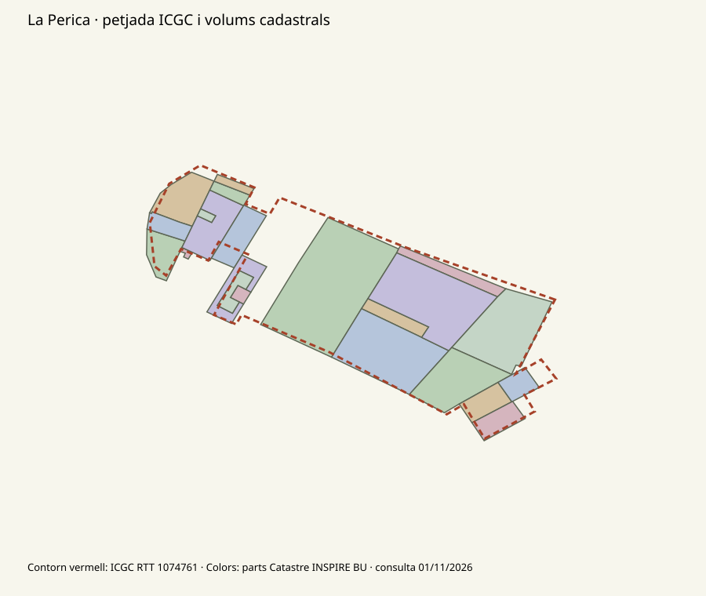

# Paisatge 3D: dades, geometria i pla de treball

2026-11-01 · RO-002 / RO-023 / RO-026 / RO-032–RO-035. Estudi i primer contrast de dades; no implica que aquestes funcions estiguin implementades. Seguiment al [backlog](BACKLOG.md).

## Resultat immediat: el megabloc de la Perica

Consulta real al WFS INSPIRE del Catastre, al voltant del polígon ICGC RTT **1074761** de Tamariu. El servei ha retornat **26 edificis i 84 parts** a l’envolupant consultada. Després d’excloure de l’experiment quatre parts amb zero plantes sobre rasant, **22 volums intersecten el megabloc**, amb **9 identificadors de família** diferents. Per tant, hi ha una font que aporta divisions geomètriques que no tenim a l’ICGC RTT de la mostra. Una part cadastral és un volum, no necessàriament una casa independent.

La unió de les interseccions cobreix aproximadament **1.475 dels 1.723 m²** de la petjada RTT, un **85,6%**. No s’han comprovat les discrepàncies sobre el terreny: poden existir diferències de contorn, dates, semàntica o omissions. No es pot substituir cegament el polígon sencer ni donar per reals totes les noves divisions. Tampoc s’ha validat encara la millora en una segona zona.



### Reproducció i mostra local

Servei: `https://ovc.catastro.meh.es/INSPIRE/wfsBU.aspx`. Paràmetres de les dues consultes:

```text
service=wfs
version=2.0.0
request=getfeature
typenames=BU.BUILDING          (segona consulta: BU.BUILDINGPART)
bbox=516969.4300002485,4640659.629895863,517080.67000024975,4640754.509895863
srsname=EPSG::25831
```

Respostes HTTP 200, aproximadament 121 i 209 kB, capçalera `Access-Control-Allow-Origin: *`. És una comprovació de resposta/capçalera; encara falta provar el futur adaptador dins del navegador. La documentació admet consultes per caixa de fins a 4 km² / 5.000 elements: [WFS d’edificis del Catastre](https://www.catastro.hacienda.gob.es/webinspire/documentos/inspire-bu-wfs.pdf).

S’ha preparat **localment** `output/tamariu-perica-catastre.geojson`, un experiment derivat per provar amb l’importador existent. Conté 80 parts amb plantes sobre rasant; exclou quatre parts amb zero plantes (una declara soterrani), sense superposar les envolupants de les mateixes famílies. Reprojecta d’ETRS89 UTM 31 a WGS84 i identifica les altures com a estimacions de plantes × 3 m. No hi ha mesures de cobertes en aquesta resposta. `beginLifespanVersion` és la versió del registre, no una data d’aixecament acreditada.

Per provar-lo, situar el centre a **41.91814, 3.20528**, usar 15 × 15 cm a 1:1.000 i carregar-lo com a GeoJSON local a «Relleu i edificis». És un retall de recerca, **no tota la mostra de Tamariu**: la importació substitueix tots els edificis del retall i no completa els que falten. El mode limitat manté les cobertes horitzontals per cada part. El fitxer experimental i els GML originals no es distribueixen amb la web; la figura és una comparació derivada. [Condicions de la font](https://www.catastro.hacienda.gob.es/webinspire/documentos/Licencia.pdf); la llicència MIT del codi no substitueix les condicions de les dades.

### Política de fonts a provar

1. Comparar aquest mateix cas, una casa aïllada, un pati i una segona zona amb parts del Catastre, RTL, RTT i OSM original. Mesurar cobertura i contorns, no només comptar polígons.
2. Triar una família coherent d’edifici i parts. No afegir l’envolupant com un altre volum damunt les parts; no interpretar cada part com un habitatge ni inventar línies entre cases.
3. Conservar els buits i les discrepàncies. Qualsevol complement d’una altra font ha de fer explícits els solapaments i residus; evitar cobrir totes les parts amb el megabloc original.
4. Provar una font opcional de més detall, amb límits de consulta i avís de substitució, abans de canviar el mode automàtic. La resposta CORS observada facilita estudiar-ho sense servidor propi, però no garanteix disponibilitat ni autoritza redistribució indiscriminada.

## Cobertes i volums singulars — RO-032

El motor actual extrudeix petjades amb coberta plana. Les tessel·les OpenMapTiles que usem documenten altura aproximada, altura mínima i `hide_3d`, però no la forma de teulada en aquesta capa: [esquema d’edificis](https://openmaptiles.org/docs/schema/#building). Cal obtenir atributs originals o un model 3D adequat.

[OSM Simple 3D Buildings](https://wiki.openstreetmap.org/wiki/Simple_3D_Buildings) descriu contorns, parts i atributs de coberta. Primera prova proposada: pla, dues aigües i una cúpula amb forma, altura i orientació disponibles. `height` i `roof:height` s’han d’interpretar conjuntament per no sumar la coberta dues vegades; direccions respecte al nord s’han de convertir al sistema del retall girat. Si falten els paràmetres necessaris, conservar el volum simplificat amb avís.

Una torre amb tota la façana corba no es resol necessàriament posant una cúpula damunt d’una extrusió. Per la Torre Glòries o altres formes singulars cal comparar parts/seccions o una malla 3D de la font, sense declarar que una aproximació paramètrica és una reconstrucció fidel. [CityGML](https://www.ogc.org/standards/citygml/) i [CityJSON](https://www.cityjson.org/about/) són candidats de model de dades; no acrediten la cobertura real d’un lloc concret.

**Acceptació:** volum tancat, patis conservats, sense doble coberta ni duplicació de parts, mateixa malla en preview/exportació i simplificació segons escala. Els modes de limitar/aplanar han de continuar sent decisions de l’usuari; el detall realista no els ha de sobreescriure. No hi ha encara un generador de cobertes noves.

## Ponts i viaductes — RO-033

El codi actual inclou els ponts en els camins que segueixen el MDT. Els túnels s’ometen de la capa superficial; no es perfora el terreny. L’esquema de transport aporta `brunnel` i `layer`: el primer identifica pont/túnel i el segon no és una altura en metres. [Esquema de transport](https://openmaptiles.org/docs/schema/#transportation), [semàntica de layer](https://wiki.openstreetmap.org/wiki/Key:layer).

Primera fase: separar el traçat del pont dels camins de superfície, conservar identificador i connexions, i cercar un perfil Z o un tauler en una font 3D. Definir amplada, gruix i suports amb dades; si algun paràmetre és una adaptació imprimible, identificar-lo com a tal. La interpolació entre extrems pot ser una aproximació opcional, però no representa qualsevol viaducte real.

Aplicar la mateixa transformació vertical a les cotes del terreny i del tauler; comprovar la connexió als accessos, les col·lisions, el pas lliure i la partició en peces quan canvia l’exageració. El gruix constructiu té una política pròpia d’escala. Casos de control: pont sobre una vall, pas superior sobre una altra carretera i cas amb cota desconeguda. El resultat ha de deixar espai buit sota el tauler quan les dades ho permetin.

## Túnels com a forats reals — RO-034

És tècnicament viable en un motor de sòlids, però un eix 2D amb `tunnel=yes` no determina per si sol un túnel: fan falta portals, cota/perfil, amplada i secció. L’MDT representa la superfície exterior de la muntanya.

Prova acotada proposada: un túnel sintètic recte amb dos portals i secció coneguda. Crear un volum al llarg de l’eix 3D i restar-lo de **totes les capes afectades**, no només ocultar el color de la carretera. Després, provar un cas real amb dades suficients. S’han de conservar base, materials, tancament i continuïtat entre peces, sense tapes que obturin el pas. Depèn de la feina d’unions/validació de RO-024; el motor Manifold existent pot servir per al prototip.

**Escala:** una secció de 8 m és de 8 mm a 1:1.000 i de 0,8 mm a 1:10.000. Cal una política explícita per als passos massa petits i el gruix restant del sostre; no eixamplar-los artificialment sense que l’usuari ho decideixi. Cal validar el laminat i els suports; eliminar els selectors de broquet no és una garantia automàtica d’impressió.

## Baumes, coves i arcs naturals — RO-035

El nostre relleu és una funció d’una sola altura per posició XY. Aquesta representació no pot descriure simultàniament el sostre, el buit i el terra d’una cova, ni un voladís. És una limitació del model de dades, no només de resolució.

Cal un aixecament volumètric, núvol de punts o malla que observi les superfícies necessàries. Un punt d’entrada de cova no descriu l’interior; un LiDAR aeri pot no veure la part de sota d’un arc o dins d’una bauma. Primer cas proposat: un arc petit amb malla oberta i llicència comprovada; alinear-lo amb el terreny, substituir el fragment afectat i validar-ne la unió. No s’ha identificat encara una font universal ni un conjunt concret de control.

## Ordre de treball i seguiment

| Pas | Resultat revisable | Estat |
| --- | --- | --- |
| Vegetació i exportació senzilla | Correcció de saturació/pinzell i retirada de broquet/filament | Implementat a v0.8.0; pendent de validació |
| Parts d’edificis | Comparació de la Perica i experiment local importable | Primera evidència obtinguda; segona zona i integració pendents |
| Font opcional de detall | Càrrega, família coherent, atribució i prova comparativa | Pendent |
| Cobertes paramètriques amb dades | Casos pla/dues aigües/cúpula i polígon amb pati | Pendent |
| Ponts | Tauler amb perfil propi i pas inferior | Pendent |
| Túnel sintètic, després real | Sòlid amb pas obert i comprovació al laminador | Pendent |
| Cavitats naturals | Arc amb malla observada i unió al terreny | Exploració posterior |

No s’han comprovat Pages ni CI remots. Els models realistes nous no es donen per resolts amb aquesta recerca documental.
